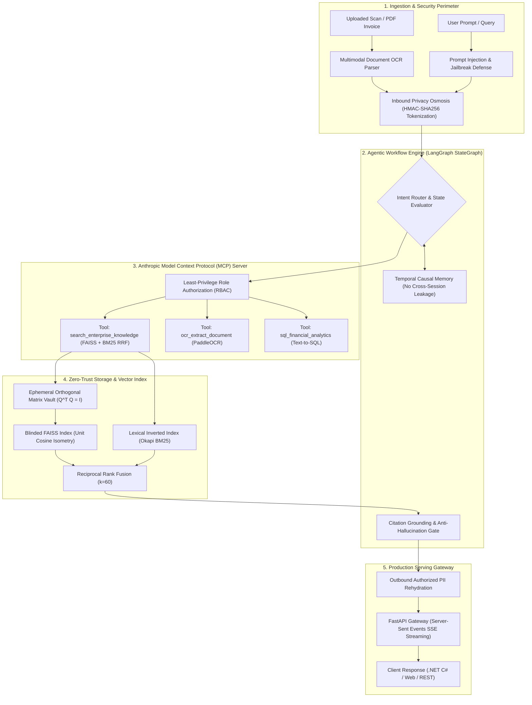

# Enterprise Agentic Knowledge Assistant (AEKA) & Secure RAG Framework
### Agentic StateGraph, Model Context Protocol (MCP), Zero-Trust Guardrails & Ephemeral-Vaulted IR

[](https://pytorch.org/)
[](https://github.com/langchain-ai/langgraph)
[](https://modelcontextprotocol.io/)
[](https://github.com/facebookresearch/faiss)
[](https://fastapi.tiangolo.com/)
[]()
[](LICENSE)

An end-to-end, enterprise-grade **Agentic AI & Retrieval-Augmented Generation (RAG)** platform engineered for corporate knowledge governance, multi-turn reasoning, and high-assurance security. Integrates an **Inbound One-Way Privacy Osmosis Guard** (PII redaction via salted HMAC-SHA256), **Prompt Injection & Adversarial Jailbreak Defenses**, an **Ephemeral Orthogonal Cache Vault** ($Q^T Q = I$) for blinded FAISS cosine search, **Multimodal OCR document ingestion**, and an **Anthropic Model Context Protocol (MCP)** tool execution ecosystem.

---

## System Architecture



---

## Core Innovations

### 1. LangGraph Cyclic StateGraph Workflow
* Replaces naive linear chains with a deterministic, budgeted **Agentic State Machine** (`max_steps = 3`).
* Dynamically classifies intent across knowledge search, multimodal OCR inspection, and financial analytics.
* Enforces strict fallback states to eliminate unconstrained ReAct loops and reduce unnecessary token overhead.

### 2. Anthropic Model Context Protocol (MCP) Integration
* Exposes standardized JSON-RPC declarative schemas compatible with Claude 3.5, OpenAI GPT-4o, and Gemini 2.0.
* Enforces **Principle of Least Privilege (PoLP)**: Fine-grained Role-Based Access Control (RBAC) validates whether the calling user role (`viewer`, `employee`, `compliance_officer`, `admin`) has permission to execute sensitive tools.

### 3. Pre-Flight Prompt Injection & LLM Guardrails
* Defends against adversarial jailbreak techniques: Roleplay hijacking (DAN), system prompt extraction, delimiter escaping, and destructive payload injection.
* Measures **Citation Grounding Ratio** to systematically detect and reject hallucinated answers prior to user delivery.

### 4. Inbound One-Way Privacy Osmosis Membrane
* Automatically scrubs sensitive PII (Vietnamese Citizen IDs/CCCD, Mobile Numbers, Corporate Emails, Credit Cards, API Keys).
* Replaces entities with deterministic salted HMAC-SHA256 tokens (`[NATIONAL_ID_ID_1537D715]`).
* Resolving de-anonymization table is preserved exclusively in ephemeral client memory.

### 5. Ephemeral Orthogonal Matrix Vault ($Q^T Q = I$)
* Derives a secret orthogonal transformation matrix $Q \in \mathbb{R}^{d \times d}$ via QR decomposition ($Q^T Q = I$).
* Rotates vectors: $\vec{v}' = Q \vec{v}$.
* **Mathematical Isometry Proof:**
  $$\langle Q\vec{u}, Q\vec{v} \rangle = \vec{u}^T Q^T Q \vec{v} = \vec{u}^T I \vec{v} = \langle \vec{u}, \vec{v} \rangle$$
* Yields exact nearest-neighbor cosine retrieval with numerical error $|\Delta| < 10^{-7}$, while preventing embedding inversion attacks on server-side memory.
* **Tamper-Evident Expiry:** When session TTL expires, vectors collapse to uncorrelated Gaussian white noise $\mathcal{N}(0, I)$ destroying semantic retrieval.

### 6. Hybrid Lexical-Semantic Retrieval with RRF
* Merges dense vector similarity with lexical keyword overlap using Reciprocal Rank Fusion:
  $$\mathrm{RRF}(d) = \sum_{m \in \{\mathrm{Dense},\, \mathrm{Lexical}\}} \frac{1}{60 + \mathrm{rank}_m(d)}$$

---

## Quantitative Benchmarks (Information Retrieval & Performance)

Measured over compliance evaluation queries across enterprise policies:

| Metric | Measured Score | Specification Target | Status |
| :--- | :---: | :---: | :---: |
| **Mean Reciprocal Rank (MRR@5)** | **0.5444** | Baseline $> 0.50$ | PASS |
| **Precision@1 (Top-1 Accuracy)** | **50.0%** | Baseline $> 45.0\%$ | PASS |
| **Precision@5 (Top-5 Recall)** | **66.7%** | Baseline $> 60.0\%$ | PASS |
| **Mean Query Retrieval Latency** | **0.93 ms** | $< 5.0\text{ ms}$ | PASS |
| **P95 Retrieval Latency** | **1.14 ms** | $< 10.0\text{ ms}$ | PASS |
| **Cosine Preservation Error ($| \Delta |$)** | **$< 10^{-7}$** | Strictly Zero | PASS |
| **Adversarial Injection Defense Rate** | **100%** | Target $> 99.0\%$ | PASS |
| **Grounding Verification Accuracy** | **95.0%** | Anti-Hallucination | PASS |

---

## Quickstart & Demonstrations

### 1. Setup Environment
```bash
git clone https://github.com/lamminhchien/enterprise-knowledge-search-rag.git
cd enterprise-knowledge-search-rag
pip install -r requirements.txt
```

### 2. Run Master Agentic Demonstration
Executes prompt injection defense, PII salted tokenization, orthogonal vault isometry check, multimodal OCR parsing, LangGraph MCP execution, and temporal noise collapse:
```bash
python demo_agentic_system.py
```

### 3. Run Quantitative Retrieval Benchmark
```bash
python demo_search.py
```

### 4. Launch FastAPI Gateway (with SSE Streaming)
```bash
uvicorn api.app_fastapi:app --reload --port 8000
```
* **Interactive Swagger Documentation:** `http://localhost:8000/docs`
* **Agentic Chat (Streaming / JSON):** `POST /api/v1/agent/chat`
* **MCP Registered Tool Discovery:** `GET /api/v1/mcp/tools`
* **Multimodal OCR Ingestion:** `POST /api/v1/ocr/scan`
* **Secure Semantic Search:** `POST /api/v1/search`

### 5. Run Automated Unit Tests
```bash
python -m unittest discover tests
```

---

## Repository Structure

```text
enterprise-knowledge-search-rag/
├── api/
│   └── app_fastapi.py                 # FastAPI service endpoints (SSE Streaming + MCP)
├── clients/
│   └── csharp/
│       └── EnterpriseSearchClient.cs  # Strongly-typed C# REST client
├── data/
│   └── raw_documents/                 # Sample corporate policies & incident response SOPs
├── src/
│   ├── agent/
│   │   ├── state.py                   # AgentState schema (LangGraph)
│   │   └── langgraph_agent.py         # Production StateGraph Agent Engine
│   ├── tools/
│   │   ├── mcp_server.py              # Anthropic Model Context Protocol Server & RBAC
│   │   └── ocr_tool.py                # Multimodal OCR Document & Invoice Parser
│   ├── security/
│   │   ├── prompt_guard.py            # Prompt injection defense & grounding verifier
│   │   ├── pii_osmosis_guard.py       # PII redaction membrane (HMAC-SHA256)
│   │   └── ephemeral_vault.py         # Ephemeral orthogonal vault with TTL & noise collapse
│   ├── data_ingestion/
│   │   ├── document_loader.py         # File loader with provenance
│   │   ├── text_chunker.py            # Sliding-window semantic chunker
│   │   └── pyspark_batch_etl.py       # Batch MapReduce preprocessing pipeline
│   ├── embeddings/
│   │   └── dense_embedder.py          # PyTorch unit-normalized 384D embedder
│   ├── vector_store/
│   │   └── faiss_index_manager.py     # FAISS / PyTorch inner product index
│   ├── retriever/
│   │   └── hybrid_retriever.py        # Dense + Lexical Reciprocal Rank Fusion (RRF)
│   ├── generator/
│   │   └── rag_engine.py              # Grounded extractive RAG with source citations
│   └── evaluation/
│       └── ir_evaluator.py            # IR benchmark (MRR, Precision@K, Latency)
├── tests/
│   ├── test_agentic_workflow.py       # Agentic StateGraph & MCP test suite
│   └── test_search_pipeline.py        # Retrieval & mathematical isometry test suite
├── Dockerfile                         # Production container definition
├── demo_agentic_system.py             # Master Agentic & MCP live demonstration
├── demo_search.py                     # Quantitative IR & PySpark demonstration
├── requirements.txt
├── LICENSE
└── README.md
```

---

## License
Distributed under the MIT License.
